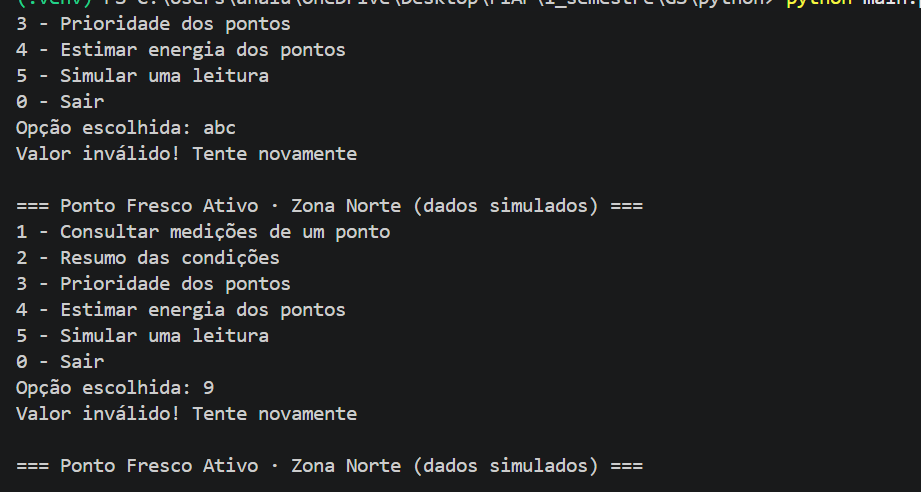
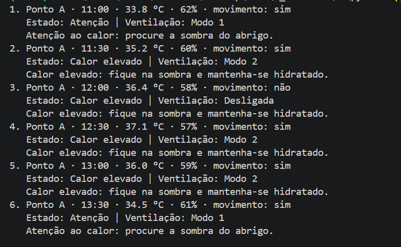
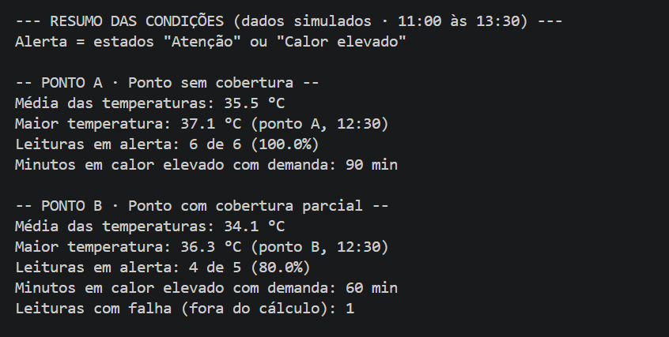
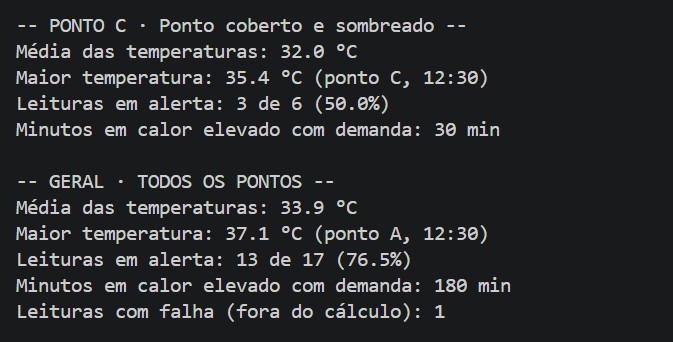
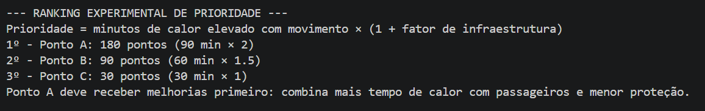
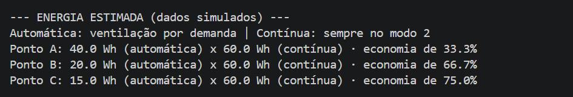

> Ficha da CitizenTech e visão geral do projeto: [README principal](../README.md)

# Ponto Fresco Ativo · Python

**Global Solution 2026.2 · FIAP · CitizenTech**
Disciplina: Computational Thinking with Python · Engenharia de Software, 1º ano

## Equipe

| Nome completo | RM |
|---|---|
| Ana Luisa Rodrigues Pimentel | RM576025 |
| Anna Clara Camillo Rodrigues | RM575371 |

## Sobre o programa

O **Ponto Fresco Ativo** é uma proposta de abrigo inteligente para pontos de ônibus da Zona Norte do Rio de Janeiro. Ele combina sombra, ventilação acionada automaticamente pelo calor e pela presença de passageiros, e dados que ajudam a decidir quais pontos devem ser melhorados primeiro.

Este programa é o "cérebro" da solução. Ele analisa leituras de **temperatura, umidade e movimento** em pontos de ônibus, **classifica** cada leitura, **decide o modo da ventilação** do abrigo, **resume** as condições e monta um **ranking experimental de prioridade** entre os pontos.

Nesta versão experimental, o programa analisa três pontos de ônibus de Del Castilho, na Zona Norte. A estrutura foi pensada para ser ampliada: para incluir novos pontos e bairros, basta acrescentar os locais na lista PONTOS e suas leituras em LEITURAS, e as mesmas funções calculam o resumo, a energia e a prioridade de todos eles.

## Como rodar

Requisitos: **Python 3.10 ou superior** (o programa usa `match/case`). Não é preciso instalar nenhuma biblioteca. Para conferir a versão instalada, rode `python --version`.

**1. Baixe o repositório para o seu computador.** O programa roda localmente, então é preciso ter os arquivos na sua máquina antes de executar.

Repositório: [LINK DO REPOSITÓRIO](https://github.com/usuario/repositorio)

Com Git:

```bash
git clone https://github.com/usuario/repositorio.git
cd repositorio
```

Sem Git: no GitHub, clique em **Code → Download ZIP**, extraia o arquivo e abra o terminal dentro da pasta extraída.

**2. Entre na pasta do Python e execute o programa:**

```bash
cd python
python main.py
```

No macOS ou Linux, pode ser necessário usar `python3 main.py`.

Navegue pelo menu digitando o número da opção e pressionando Enter. Para encerrar, digite `0`.

## Menu e funcionalidades

As opções do menu saem da jornada de quem usa a solução e dos requisitos definidos em Software & Total Experience.

| Opção | O que faz | Para quem | Requisito |
|---|---|---|---|
| 1 - Consultar medições de um ponto | Mostra cada leitura do ponto escolhido (A, B, C ou T para todos) com estado, modo da ventilação e mensagem ao passageiro | Passageiro e equipe de manutenção | RF02, RF03, RF04 |
| 2 - Resumo das condições | Média e maior temperatura (com ponto e horário), % de leituras em alerta, minutos em calor elevado com demanda e leituras com falha, por ponto e no geral | Equipe técnica | RF06 |
| 3 - Prioridade dos pontos | Ranking experimental: qual ponto deve receber melhorias primeiro, com a conta de cada um | Gestor público | RF07 |
| 4 - Estimar energia dos pontos | Energia gasta pela ventilação automática comparada a uma ventilação sempre ligada, e a economia em % | Gestor público e equipe técnica | Indicador energético |
| 5 - Simular uma leitura | O usuário digita uma leitura e vê como o abrigo reagiria (ver seção própria abaixo) | Quem quer entender a lógica | RF05 |
| 0 - Sair | Encerra o programa | Todos | |

## Dados simulados

**Todos os dados do programa são simulados.** As leituras e os fatores de infraestrutura foram criados para o projeto (com apoio de IA) para testar e demonstrar a lógica. Nenhum valor foi medido em campo.

### Os pontos (lista `PONTOS`)

Os pontos A, B e C correspondem a **locais reais de observação escolhidos para o desafio**, na região de Del Castilho, Zona Norte do Rio.

As **situações de cobertura desses pontos foram simuladas** no programa, para que o código tenha os três tipos de proteção diferentes e o ranking possa ser comparado. Elas não representam a condição real de cada local, que ainda será verificada na observação de campo.

| Ponto | Local de observação | Cobertura (simulada) | Fator de infraestrutura (simulado) |
|---|---|---|---|
| A | Av. Pastor Martin Luther King, 98 | Sem cobertura | 1 |
| B | Av. Dom Hélder Câmara, 3196 | Cobertura parcial | 0,5 |
| C | Estrada Adhemar Bebiano, 550 | Coberto e sombreado | 0 |

O **fator de infraestrutura** representa o quanto o ponto já é protegido: 0 para coberto e sombreado, 0,5 para proteção parcial e 1 para sem cobertura. Ele é usado apenas no cálculo da prioridade.

### As leituras (lista `LEITURAS`)

A lista `LEITURAS` contém **valores fictícios que imitam o que o ESP32 do circuito (Edge Computing) mediria** em cada ponto. Cada registro tem o formato:

```
[ponto, hora, temperatura (°C), umidade (%), movimento recente]
```

- **18 registros**, 6 por ponto.
- **Janela de observação simulada:** das 11:00 às 13:30, uma leitura a cada 30 minutos, nos mesmos horários para os três pontos. Assim a comparação entre eles é justa.
- **Movimento recente** (`True` ou `False`) representa o que o sensor de movimento (PIR) detectou, ou seja, se havia passageiros esperando.
- **Falha de leitura:** o registro do ponto B às 13:00 tem temperatura `None`, simulando um sensor com defeito. O programa reconhece a falha e a deixa fora dos cálculos.

## Regra de decisão compartilhada

As faixas, os estados, as mensagens e os modos de ventilação abaixo são **os mesmos no circuito (Edge), no site (JavaScript) e neste programa**. Os limites de temperatura são valores experimentais definidos pela equipe para o protótipo. **Não são níveis oficiais de calor do COR nem critérios de saúde.**

### Classificação da temperatura (`classificar`)

| Índice | Faixa | Estado | Mensagem ao passageiro |
|---|---|---|---|
| 0 | abaixo de 30 °C | Normal | Condição confortável para a espera. |
| 1 | de 30 °C até abaixo de 35 °C | Atenção | Atenção ao calor: procure a sombra do abrigo. |
| 2 | 35 °C ou mais | Calor elevado | Calor elevado: fique na sombra e mantenha-se hidratado. |
| 3 | leitura ausente (`None`) | Falha de leitura | Sensor com falha: leitura indisponível. |

Os estados e as mensagens ficam em duas **listas paralelas** (`ESTADOS` e `MENSAGENS`): o índice retornado pela classificação é o mesmo nas duas.

### Modo da ventilação (`decidir_ventilacao`)

| Modo | Quando | Potência estimada |
|---|---|---|
| Desligada | Sem movimento, estado Normal ou falha de leitura | 0 W |
| Modo 1 | Estado Atenção **com** movimento | 10 W |
| Modo 2 | Estado Calor elevado **com** movimento | 20 W |

A ventilação só liga quando há calor **e** passageiros esperando. Em caso de falha do sensor, o abrigo fica no estado seguro (desligado). As potências são estimativas para o cálculo de energia.

## Cálculos

- **Média e maior temperatura:** calculadas percorrendo a lista com `for`, sem usar `sum()` ou `max()`. Leituras com falha ficam de fora.
- **% de leituras em alerta:** **alerta = estados "Atenção" ou "Calor elevado"** (índices 1 e 2). O percentual é `leituras em alerta / leituras válidas × 100`.
- **Minutos em calor elevado com demanda:** quantidade de leituras em "Calor elevado" **com** movimento × 30 minutos.
- **Prioridade (ranking experimental):**

  ```
  prioridade = minutos em calor elevado com movimento × (1 + fator de infraestrutura)
  ```

  Quanto maior o valor, antes o ponto deveria receber melhorias. O ranking é experimental: serve para demonstrar como os dados podem apoiar decisões, mas não substitui critérios técnicos, sociais ou de segurança do poder público.

- **Energia estimada:** `potência do modo × 0,5 h` para cada leitura (cada leitura representa 30 minutos). A comparação usa um ventilador "contínuo", sempre no Modo 2, e mostra a economia da ventilação por demanda.

### Resultados com os dados simulados

| Ponto | Média | Máxima | Em alerta | Calor + passageiros | Prioridade | Energia (automática / contínua) |
|---|---|---|---|---|---|---|
| A | 35,5 °C | 37,1 °C (12:30) | 6 de 6 (100%) | 90 min | 180 | 40 / 60 Wh (economia de 33,3%) |
| B | 34,1 °C | 36,3 °C (12:30) | 4 de 5 (80%), 1 falha | 60 min | 90 | 20 / 60 Wh (economia de 66,7%) |
| C | 32,0 °C | 35,4 °C (12:30) | 3 de 6 (50%) | 30 min | 30 | 15 / 60 Wh (economia de 75,0%) |
| Geral | 33,9 °C | 37,1 °C (A, 12:30) | 13 de 17 (76,5%), 1 falha | 180 min | n/a | n/a |

## Simular uma leitura (opção 5)

A opção 5 existe **apenas para demonstrar o funcionamento da lógica** a quem quiser entendê-la: o usuário faz o papel do sensor, digita temperatura, umidade e se há movimento, e o programa mostra o estado, o modo da ventilação e a mensagem que o abrigo exibiria.

**A simulação não entra nos dados do projeto:**

- As leituras simuladas são guardadas em uma lista separada, `simulacoes`, e **nunca em `LEITURAS`**.
- Elas **não são usadas por nenhuma outra função do programa**: não aparecem nas medições, não alteram o resumo, o ranking de prioridade nem a energia estimada.
- As leituras simuladas **não têm horário** (são registradas como "sem horário").
- A lista `simulacoes` existe só enquanto o programa está aberto: ao fechá-lo, as simulações são apagadas.

## Tratamento de entradas inválidas

Nenhuma entrada derruba o programa:

- **Menu:** a opção é lida como texto e comparada com as opções válidas. Letras, números fora do menu, espaços ou Enter vazio mostram "Valor inválido" e o menu volta.
- **Ponto:** aceita A, B, C ou T, em maiúscula ou minúscula. Qualquer outro valor pede de novo.
- **Temperatura e umidade:** usam `try/except ValueError` na conversão para número, aceitam vírgula como separador decimal (`36,2`) e conferem a faixa esperada (temperatura de -10 a 60 °C, umidade de 0 a 100%).
- **Movimento:** aceita apenas `s` ou `n` e repete a pergunta até receber uma resposta válida.

## Testes realizados

| Teste | Entrada | Resultado |
|---|---|---|
| Menu inválido | `abc`, vazio, `9` | Mensagem de inválido; o menu volta |
| Ponto inválido | `x`, depois `b` | Recusa `x` e aceita `b` minúsculo |
| Falha de leitura | Opção 1, ponto B | 13:00 aparece como "Falha de leitura", ventilação desligada |
| Calor sem movimento | Opção 1, ponto A | 12:00 (36,4 °C) em Calor elevado com ventilação desligada |
| Todos os pontos | Opção 1, `T` | 18 leituras numeradas |
| Resumo, prioridade e energia | Opções 2, 3 e 4 | Valores iguais aos da tabela de resultados |
| Limites das faixas | Opção 5 com 29.9, 30, 34.9 e 35 e movimento `s` | Normal/Desligada, Atenção/Modo 1, Atenção/Modo 1, Calor elevado/Modo 2 |
| Vírgula decimal | `36,2` | Aceita como 36,2 °C |
| Texto no lugar de número | `trinta`, vazio, `d` | "Valor inválido" e nova pergunta |
| Fora da faixa | `-11`, `61`, `nan`; umidade `120` | "Fora da faixa" e nova pergunta |
| Movimento inválido | vazio, `x`, depois `n` | Recusa e depois aceita |
| Sair | `0` | Mensagem de despedida e fim do programa |

## Print da execução

**Menu com entradas inválidas**


**Opção 1 · Consulta de medições (ponto A)**



**Opção 2 · Resumo das condições**



**Opção 3 · Ranking experimental de prioridade**


**Opção 4 · Energia estimada**


**Opção 5 · Simulação de leitura com entradas inválidas**


## Integração com as outras disciplinas

- **Edge Computing:** a lista `LEITURAS` simula as leituras do ESP32 e usa as mesmas faixas, estados e modos de ventilação do circuito.
- **Software & Total Experience:** as opções do menu saem da jornada do passageiro, da equipe técnica e do gestor público, e atendem aos requisitos RF02 a RF07.
- **Front-End Design:** as mensagens impressas são os mesmos textos exibidos na página.
- **Web Development:** a regra de decisão (`classificar` e `decidir_ventilacao`) é reescrita em JavaScript no simulador do site.
- **Matemática:** o cálculo de energia (E = P × t) e a comparação entre ventilação automática e contínua são aprofundados no relatório da disciplina.
- **Storytelling:** o programa rodando entra no videopitch como prova de funcionamento.

## Limitações

- Todos os valores são simulados; o programa demonstra a lógica, não mede o calor real dos pontos.
- O sensor de movimento detecta movimento, não o número de passageiros nem o tempo real de espera.
- A ventilação movimenta o ar, mas não necessariamente reduz a temperatura; o benefício físico do abrigo depende de um piloto real.
- O ranking de prioridade e as potências são experimentais e precisariam ser validados antes de virar ferramenta de gestão.

---

## Uso de IA generativa

Utilizamos IA generativa (Claude, da Anthropic) como apoio em quatro momentos: geração de ideias e estruturação do projeto, esclarecimento de dúvidas sobre entrada de dados, revisão e correção do rascunho escrito pelo grupo, e organização desta documentação. Todos os prompts utilizados estão no arquivo [`prompts.md`](prompts.md).